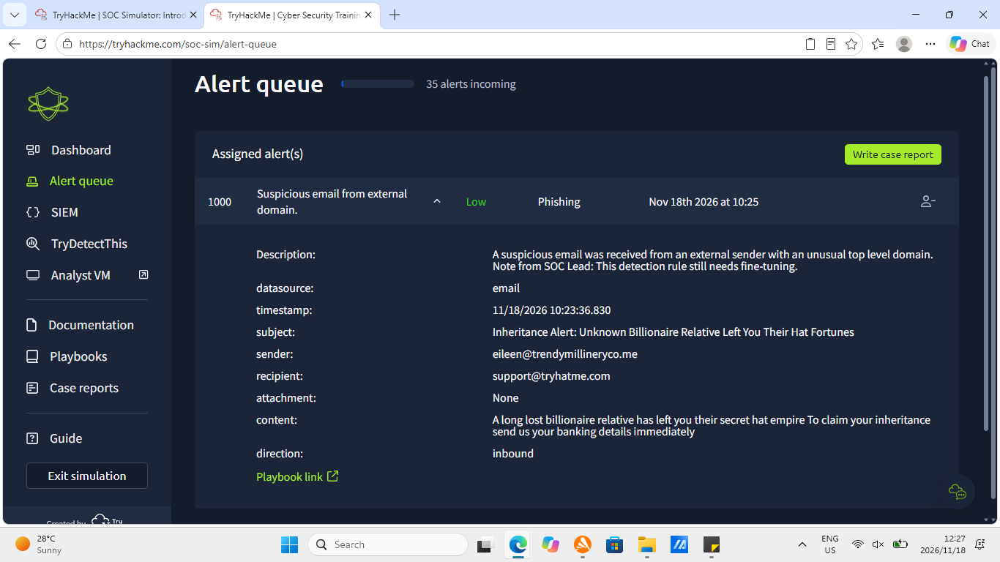
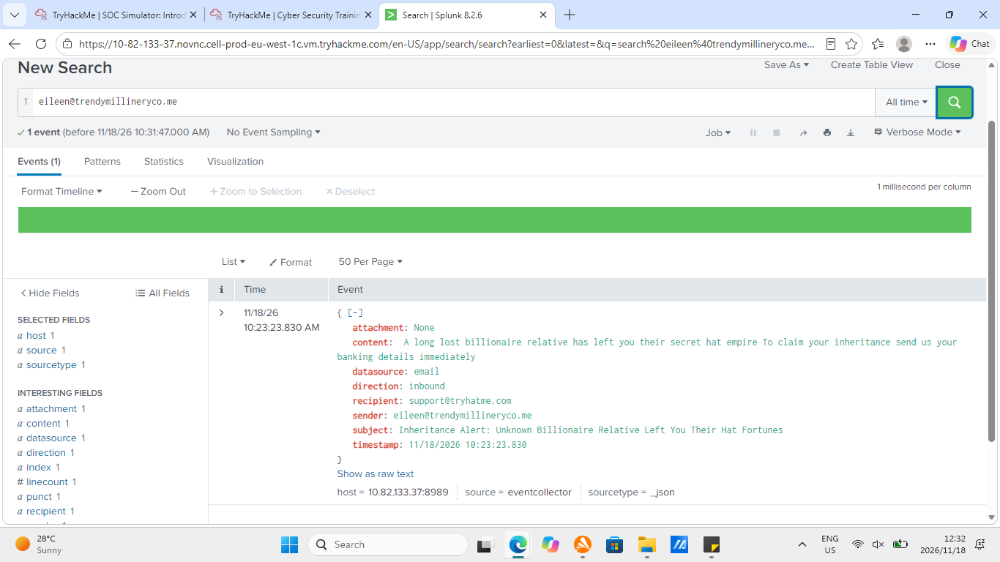

# Alert 1000: Suspicious email from external domain

| | |
|---|---|
| **Date** | 18 November 2026, 10:23 |
| **Severity** | Low |
| **Type** | Phishing |
| **Verdict** | True positive |
| **Escalated** | No |

## Summary
An inbound email from an external sender with an unusual top-level domain (.me) claimed the recipient had received an inheritance and asked for banking details.

## Investigation steps
1. Reviewed the alert details (sender, subject, content, no attachment).
2. Checked the sender in TryDetectThis (result: clean, but the tool is designed for URLs and IPs).
3. Searched the sender in Splunk (all time): one event, no replies or repeat emails.

## Evidence

## Case report

**Time of activity:** 18 November 2026, 10:23.

**Affected entities:** support[at]tryhatme[.]com (recipient), eileen[at]trendymillineryco[.]me (sender).

**Reason for classifying as true positive:** The email offers an unrealistic inheritance and asks for banking details immediately, using urgency and a too-good-to-be-true reward. The vague wording suggests a mass-sent message, and it was sent to a shared support mailbox. No links or attachments. Splunk found only this one email from the sender.

**Escalation:** Not required. Single email, no sign of a reply or of banking details being shared.

**Recommended remediation:**
- Delete the email from all affected mailboxes.
- Block the sender and the domain trendymillineryco[.]me.
- Confirm with the support team that no one replied.
- Remind staff not to send banking details by email.

**Attack indicators:**
- Sender: eileen[at]trendymillineryco[.]me
- Domain: trendymillineryco[.]me
- Subject: Inheritance Alert: Unknown Billionaire Relative Left You Their Hat Fortunes