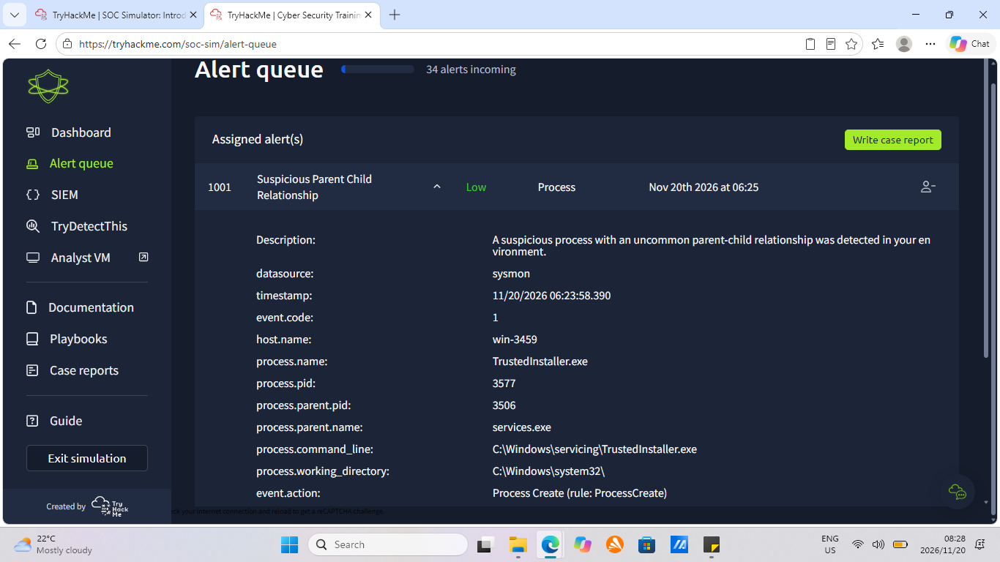
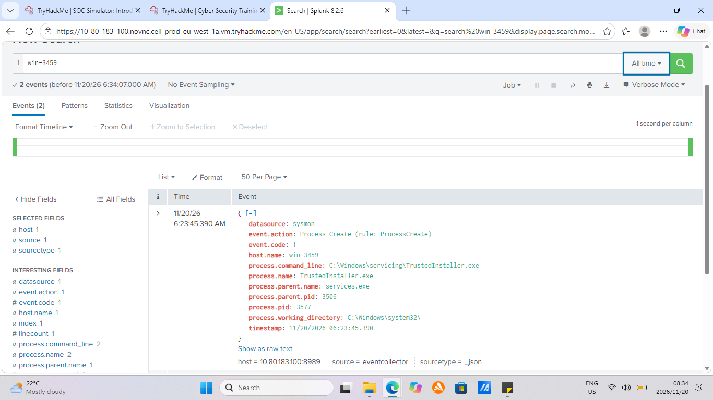
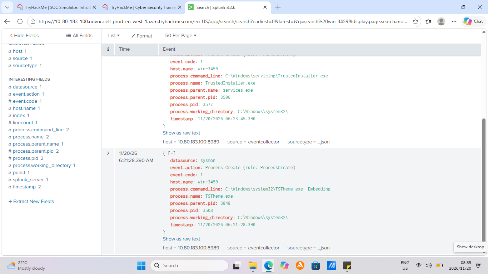

# Alert 1001: Suspicious Parent Child Relationship

| | |
|---|---|
| **Date** | 20 November 2026, 06:23 |
| **Severity** | Low |
| **Type** | Process |
| **Verdict** | False positive |
| **Escalated** | No |

## Summary
The rule flagged services.exe starting TrustedInstaller.exe on host win-3459 as an uncommon parent-child relationship.

## Investigation steps
1. Reviewed the alert: program name, parent, folder and command line.
2. Searched the host name (win-3459) in Splunk (all time): 2 events, no PowerShell, nslookup or Downloads activity.

## Evidence

## Case report

**Time of activity:** 20 November 2026, 06:23.

**Related entities:**
- Host: win-3459
- Processes: TrustedInstaller.exe (parent: services.exe), TSTheme.exe

**Reason for classifying as false positive:** services.exe starting TrustedInstaller.exe (the Windows update installer) is normal. Both are legitimate Windows programs, ran from C:\Windows\system32 with no unusual command line, and a Splunk search of win-3459 found no other suspicious activity. The rule flagged it only because the pairing is uncommon.

**Recommended action:** No action needed. Consider tuning the rule to allow this pairing.