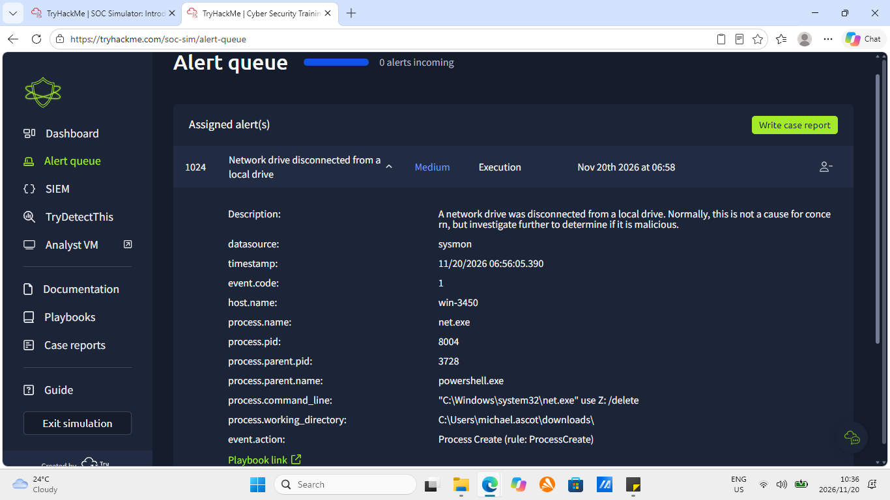
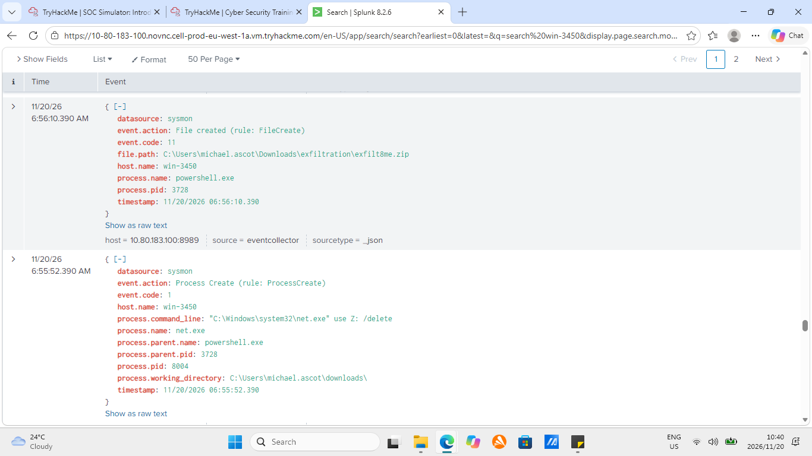

# Alert 1024: Network drive disconnected from a local drive

| | |
|---|---|
| **Date** | 20 November 2026, 06:56 |
| **Severity** | Medium |
| **Type** | Execution |
| **Verdict** | True positive |
| **Escalated** | Yes |

## Summary
powershell.exe ran "net use Z: /delete" from a user's Downloads folder, disconnecting the drive mapped in alert 1022. On its own this looks harmless, but Splunk shows it was one step in the same attack on win-3450.

## Investigation steps
1. Reviewed the alert: net.exe started by powershell.exe from C:\Users\michael.ascot\downloads.
2. Searched the host name (win-3450) in Splunk (all time) and checked the events around the alert.
3. Found powershell.exe creating exfilt8me.zip 18 seconds after the drive was disconnected.

## Evidence

## Case report

**Time of activity:** 20 November 2026, 06:55 to 06:56 (alert timestamp 06:56:05).

**Affected entities:**
- Host: win-3450
- User account: SSF\michael.ascot
- Network share: Z: drive (\\FILESRV-01\SSF-FinancialRecords)
- File: exfilt8me.zip

**Reason for classifying as true positive:** powershell.exe ran "net use Z: /delete" from the Downloads folder. A person would normally do this through File Explorer, not PowerShell. Splunk shows powershell.exe creating exfilt8me.zip in Downloads\exfiltration 18 seconds later, and the same host then sent files out through nslookup requests to haz4rdw4re[.]io (DNS data exfiltration) and connected to ngrok[.]io (reverse shell). The drive was likely disconnected to cover tracks. Same incident as alerts 1025 and 1026.

**Reason for escalating:** Data was sent out of the network, and the reverse shell may still give the attacker access to win-3450. The incident response team needs to act urgently.

**Recommended remediation:**
- Isolate win-3450 from the network.
- Disable michael.ascot and reset the password.
- Block haz4rdw4re[.]io and the ngrok[.]io address.
- Check FILESRV-01 (SSF-FinancialRecords) for files accessed from this host.
- Investigate how the attacker got in, then clean or rebuild the host.

**Attack indicators:**
- Command: net.exe use Z: /delete, started by powershell.exe
- Folder: C:\Users\michael.ascot\Downloads\exfiltration
- File: exfilt8me.zip
- Domains: haz4rdw4re[.]io, ngrok[.]io (port 19282)