# Alert 8814: Inbound Email Containing Suspicious External Link

**Platform:** TryHackMe SOC Simulator (training environment, simulated data)
**Alert severity:** Medium
**Classification:** False positive
**Escalation required:** No
**Tools used:** Splunk, TryDetectThis, company information (documentation)

## Alert details

An inbound email from onboarding@hrconnex[.]thm to j.garcia@thetrydaily[.]thm triggered a suspicious external link alert.

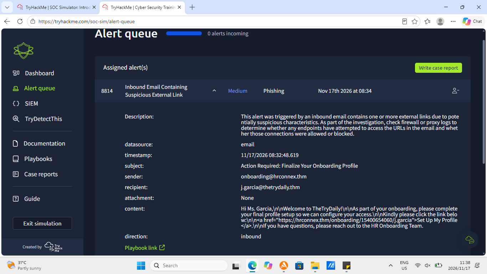

## Investigation steps

### 1. Reputation checks (TryDetectThis)
The sender address and the URL were both analyzed and returned CLEAN.

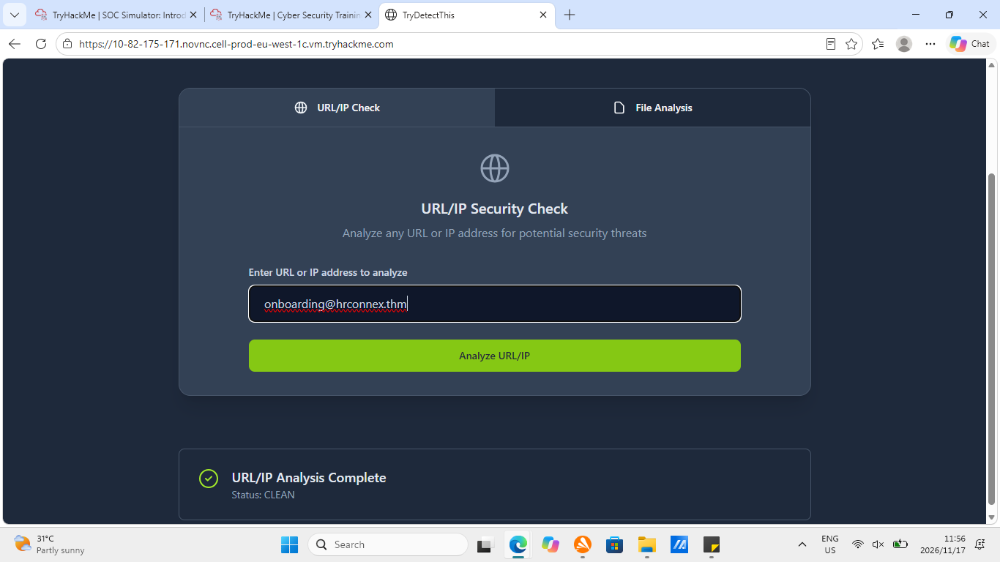
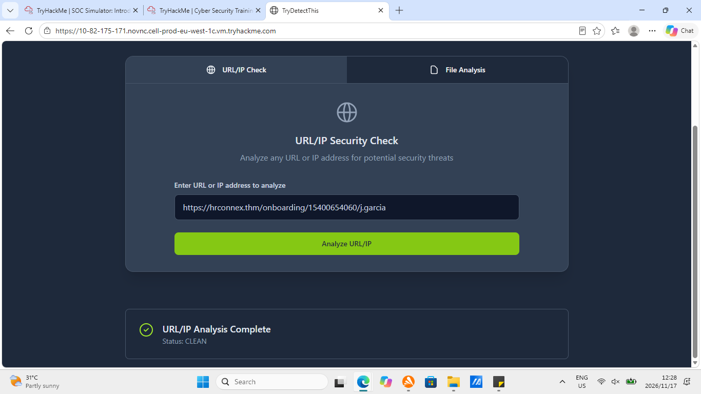

### 2. Search for the link in Splunk (all time)
The link appears in two emails, both sent only to j.garcia, at 08:32:48 and 08:38:47.

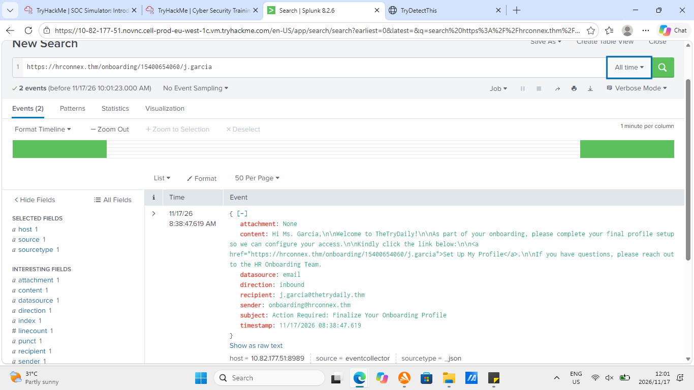
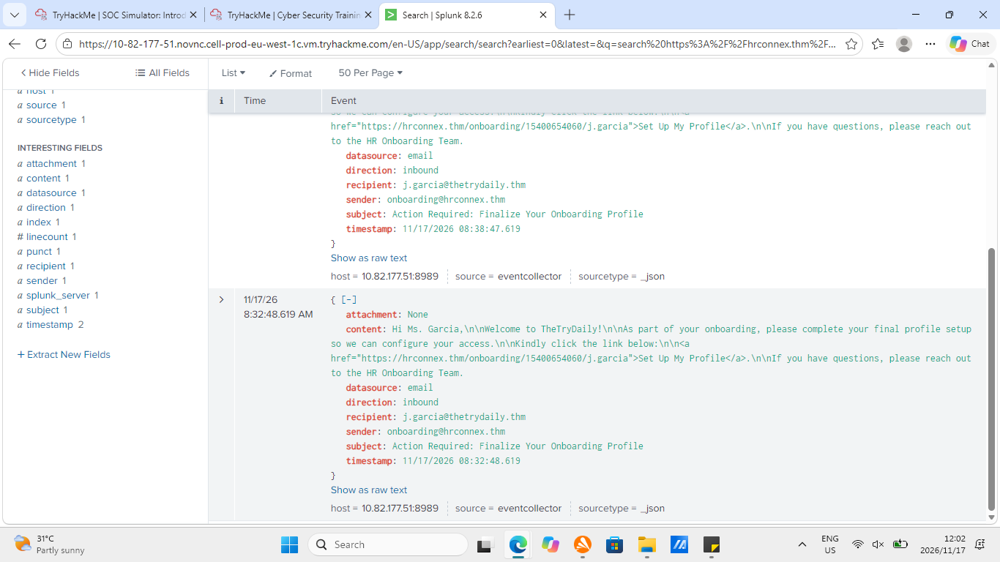

### 3. Firewall activity for the recipient's host (10.20.2.8)
Two events were found, both unrelated to the link. No connection to hrconnex[.]thm was found.

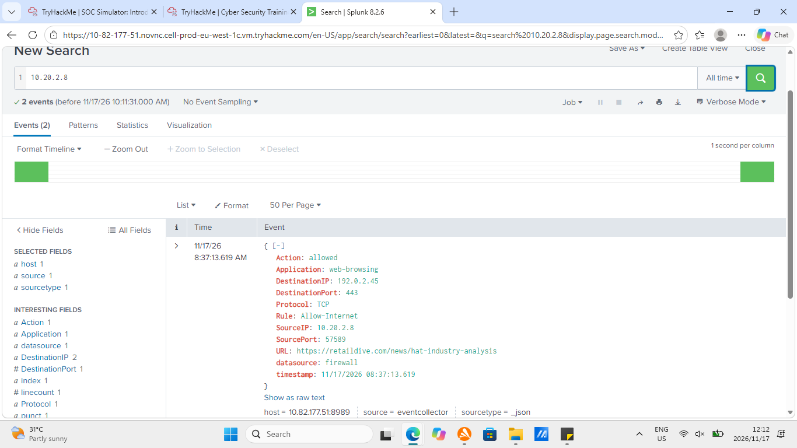
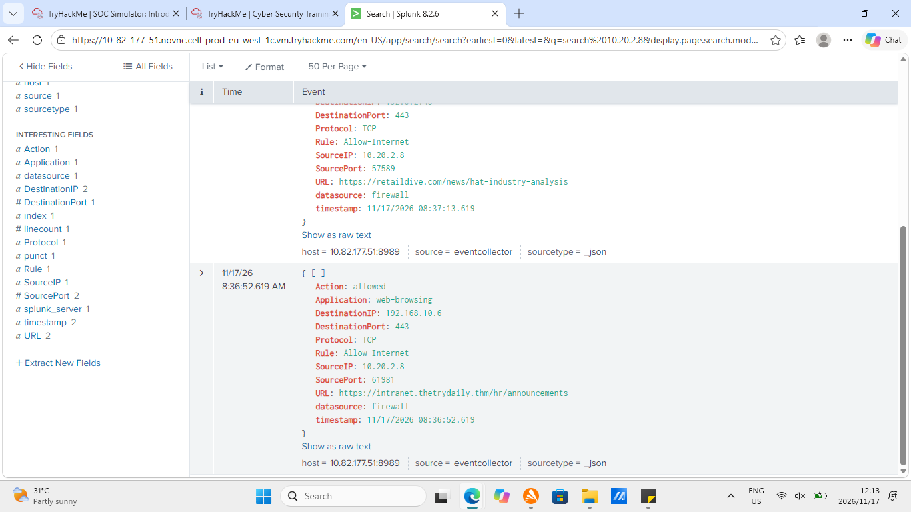

### 4. Search for the domain in Splunk (all time)
Three events: the two emails from the domain, and an internal email from HR stating that hrconnex[.]thm is the company's new third-party HR partner.

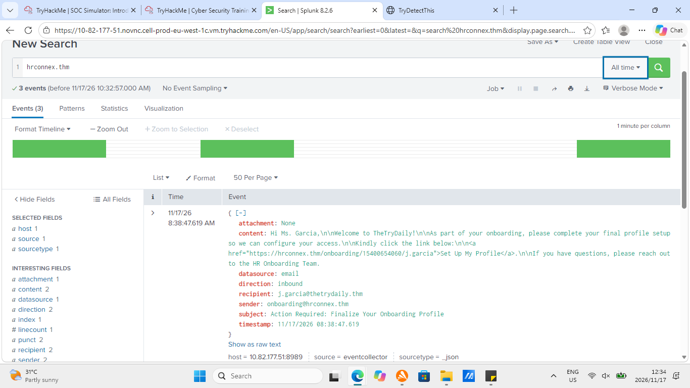
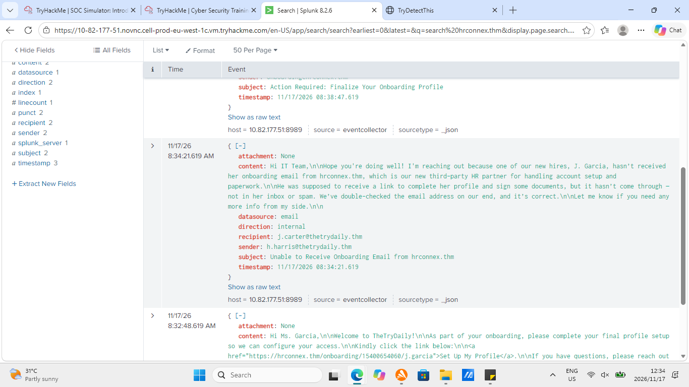
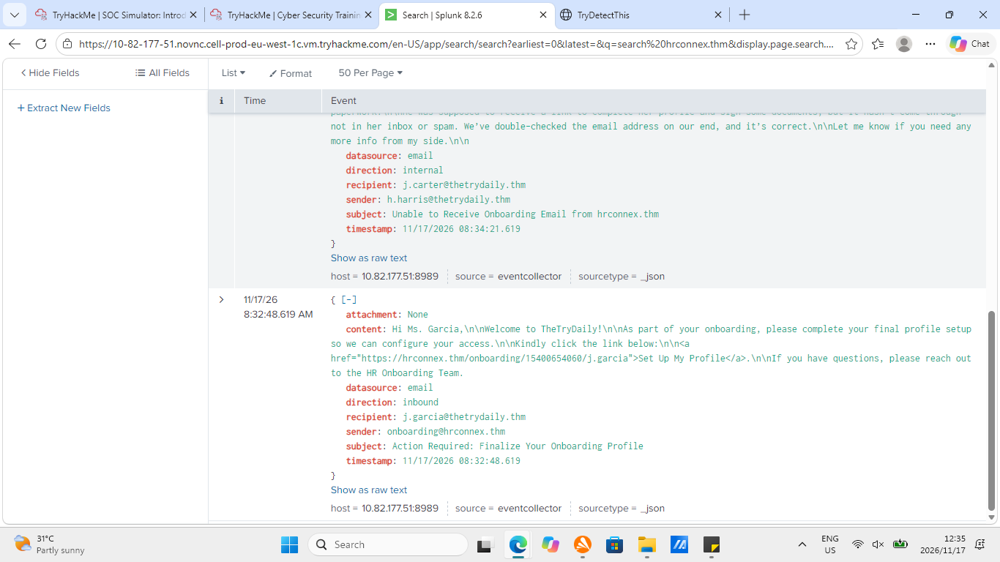

### 5. Documentation
Used to match the recipient and the internal senders to their roles and hosts.

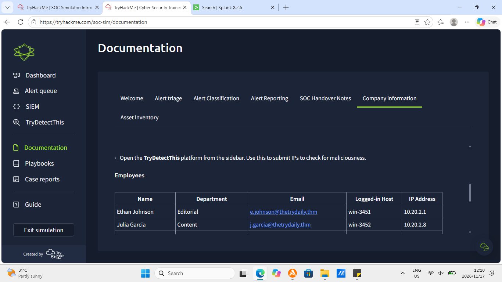
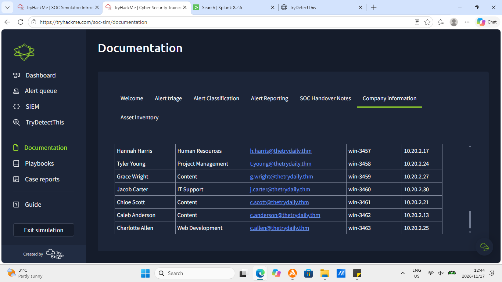

## Case report

**Time of Activity:**
On 11/17/2026 at 08:32:48, an email from onboarding@hrconnex[.]thm was delivered to j.garcia@thetrydaily[.]thm, which triggered the alert. At 08:34:21, an internal email from h.harris reported that this email had not been received. A second copy of the same email was delivered to j.garcia at 08:38:47.

**List of Related Entities:**
- Sender: onboarding@hrconnex[.]thm
- Recipient: j.garcia@thetrydaily[.]thm (Julia Garcia, Content)
- Recipient host: win-3452 (10.20.2.8)
- URL: hxxps://hrconnex[.]thm/onboarding/15400654060/j[.]garcia
- Domain: hrconnex[.]thm
- Supporting evidence: h.harris@thetrydaily[.]thm (Hannah Harris, Human Resources) sent an internal email to j.carter@thetrydaily[.]thm (Jacob Carter, IT Support) at 08:34:21, reporting that Julia Garcia had not received the onboarding email from hrconnex[.]thm

**Reason for Classifying as False Positive:**
1. The sender address (onboarding@hrconnex[.]thm) and the URL (hxxps://hrconnex[.]thm/onboarding/15400654060/j[.]garcia) were both analyzed in TryDetectThis and returned a status of CLEAN.
2. An internal email sent at 08:34:21 from h.harris (Human Resources) to j.carter (IT Support) identifies hrconnex[.]thm as the company's new third-party HR partner. This corroborates that the sender is legitimate.
3. The email greeting and the URL are both personalized to the recipient (Ms. Garcia and j.garcia), which is consistent with an automated onboarding message.
4. Firewall logs for 10.20.2.8 (win-3452, Julia Garcia's workstation) were reviewed across all time. Two events were returned, at 08:36:52 and 08:37:13. Both were allowed web-browsing connections to unrelated destinations (an internal HR announcements page and a news website). No connection to hrconnex[.]thm was found, so there is no evidence that the link was accessed from this host.
5. An all-time Splunk search for hrconnex[.]thm returned three events. Two were emails from onboarding@hrconnex[.]thm, both sent only to j.garcia@thetrydaily[.]thm, at 08:32:48 and 08:38:47. The third was the internal email from h.harris at 08:34:21. No other employees received email from this domain, and the second email followed the report that the first had not arrived, which is consistent with a resend.

**Conclusion:**
Alert 8814 is classified as a false positive. The email originated from hrconnex[.]thm, the company's third-party HR partner, and neither the sender nor the URL was flagged as malicious. Firewall logs show no connection to the link from the recipient's host. No malicious activity was identified, so no escalation or containment action is required and the alert is closed.
