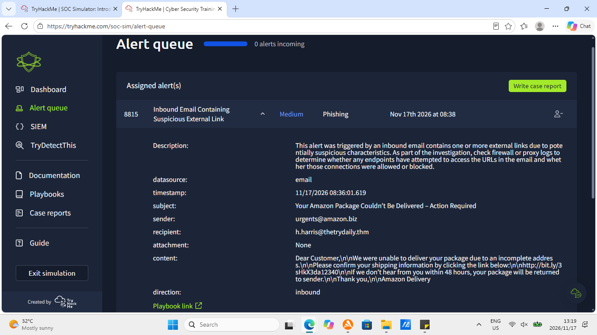
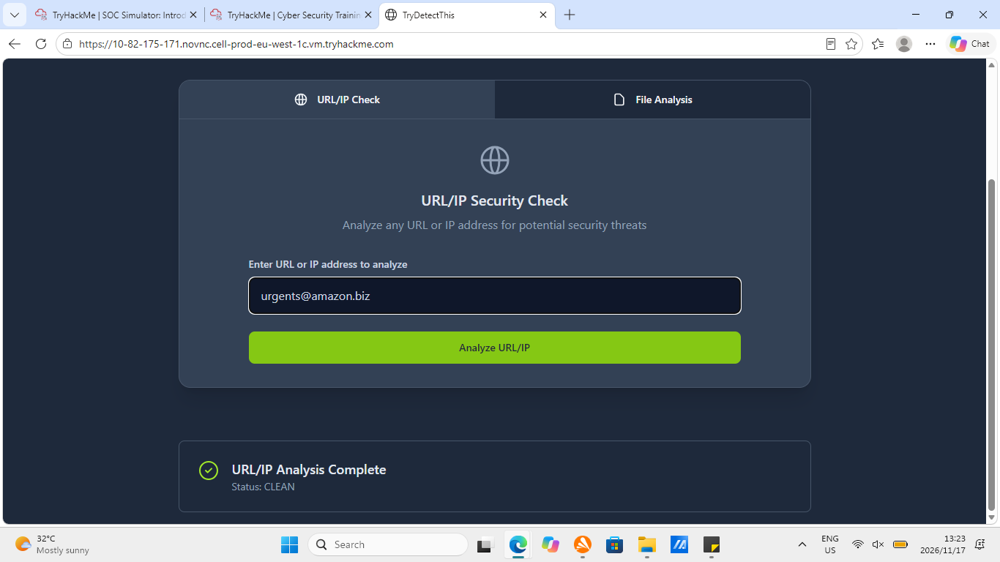
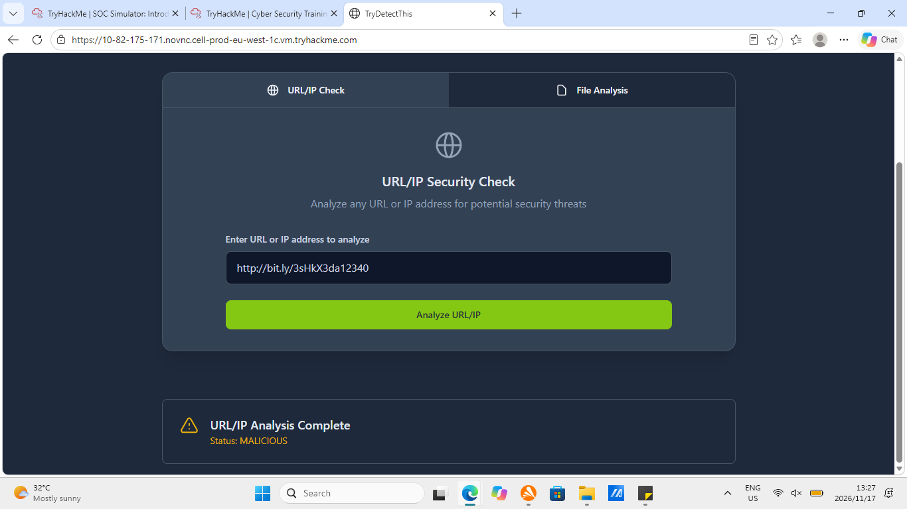
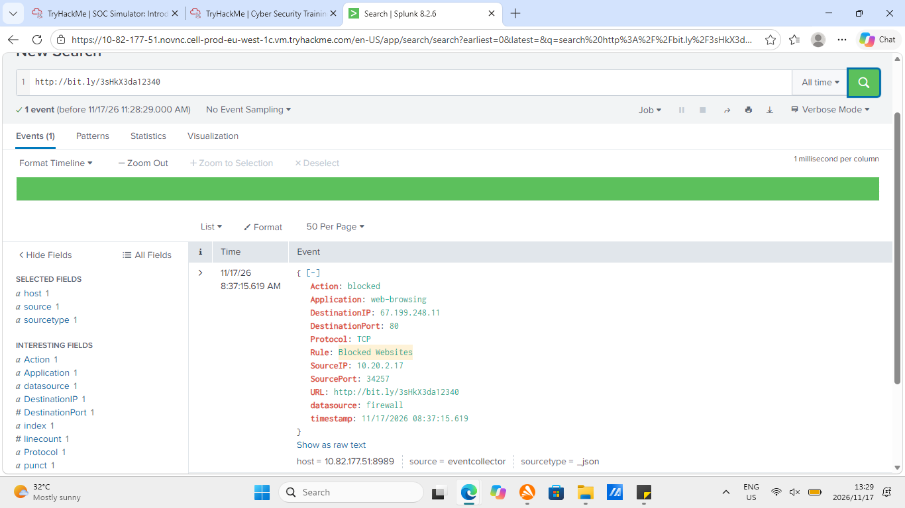
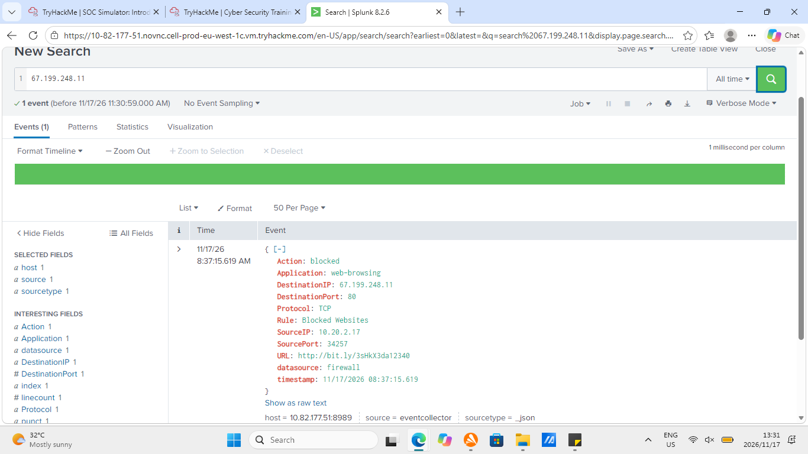
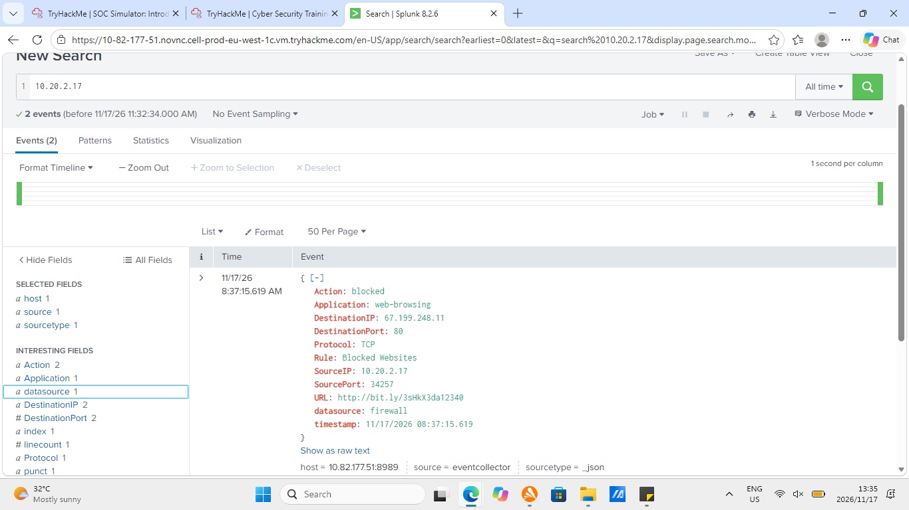
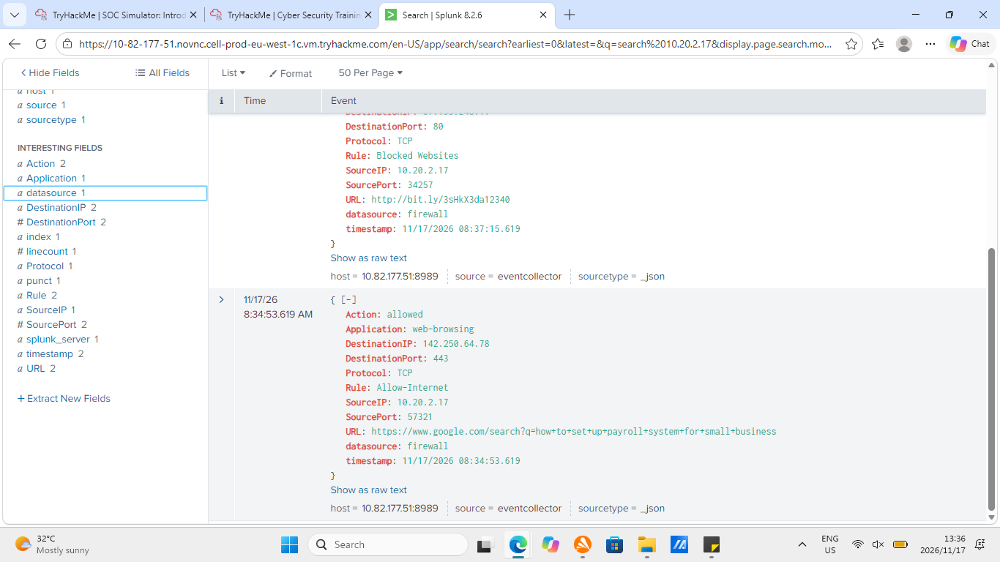
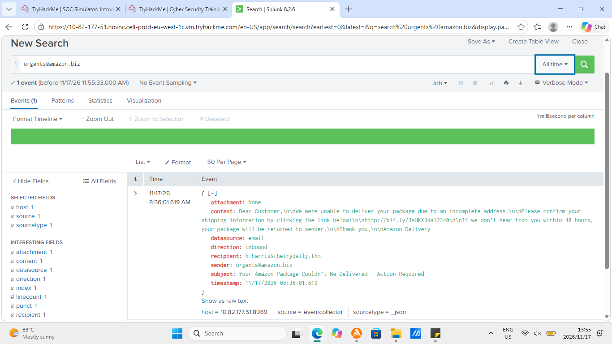
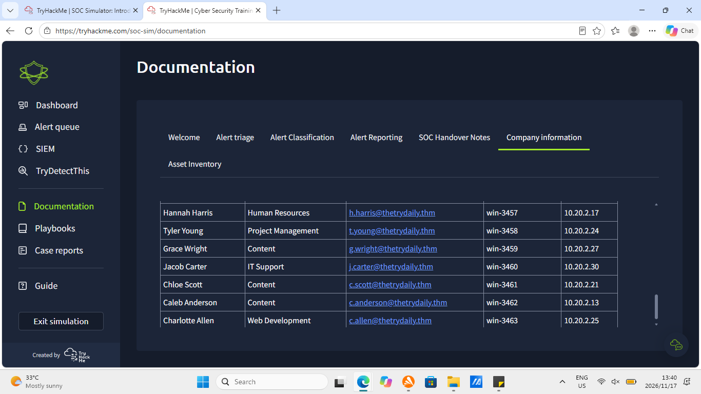

# Alert 8815: Inbound Email Containing Suspicious External Link

**Platform:** TryHackMe SOC Simulator (training environment, simulated data)
**Alert severity:** Medium
**Classification:** True positive
**Escalation required:** Yes
**Tools used:** Splunk, TryDetectThis, company information (documentation)
**Related alert:** 8816 (the firewall block of the same URL from the same host)

## Alert details

An inbound email from urgents@amazon[.]biz to h.harris@thetrydaily[.]thm triggered a suspicious external link alert. The email claims an Amazon package could not be delivered and asks the recipient to click a shortened link.

## Investigation steps

### 1. Reputation checks (TryDetectThis)
The sender address returned CLEAN. The URL returned MALICIOUS. A clean sender result only means the address is not on a known-bad list, so it does not make the sender legitimate.

### 2. Search for the link in Splunk (all time)
One event was found: a firewall event at 08:37:15 where the connection to the link was blocked.

### 3. Search for the destination IP in Splunk (all time)
The destination IP 67[.]199[.]248[.]11 returned the same single blocked event.

### 4. Firewall activity for the recipient's host (10.20.2.17)
Two events were found. The first was an allowed Google search at 08:34:53, before the email was delivered and unrelated to it. The second was the blocked connection to the link at 08:37:15.

### 5. Search for the sender in Splunk (all time)
One event was found: the email under investigation. No other employees received email from this sender.

### 6. Asset inventory
Used to match the host 10.20.2.17 to the recipient, Hannah Harris (Human Resources, win-3457).

## Case report

**Time of activity:**
On 11/17/2026 at 08:36:01, a phishing email from urgents@amazon[.]biz was delivered to h.harris@thetrydaily[.]thm, which triggered the alert. At 08:37:15, approximately one minute after delivery, the firewall blocked a connection attempt from 10.20.2.17 (h.harris's workstation) to hxxp://bit[.]ly/3sHkX3da12340 (destination IP 67[.]199[.]248[.]11, port 80).

**List of Affected Entities:**
- Sender: urgents@amazon[.]biz
- Recipient: h.harris@thetrydaily[.]thm (Hannah Harris, Human Resources)
- Recipient host: win-3457 (10.20.2.17)
- URL: hxxp://bit[.]ly/3sHkX3da12340
- Destination IP: 67[.]199[.]248[.]11
- Related alert: 8816 (firewall block of the same URL from the same host)

**Reason for Classifying as True Positive:**
1. The email impersonates Amazon using the look-alike domain amazon[.]biz. Amazon's legitimate domain is amazon.com.
2. The email uses a generic greeting ("Dear Customer"), creates urgency ("Action Required", "within 48 hours"), and asks the recipient to click a link to confirm shipping information.
3. The link uses the bit[.]ly URL shortener, which hides the real destination.
4. The URL was analyzed in TryDetectThis and returned a status of MALICIOUS. The sender address returned CLEAN, but this only means it is not in the known-bad list. It does not make the sender legitimate.
5. Firewall logs for 10.20.2.17 show the host attempted to connect to the URL at 08:37:15, and the connection was blocked by the "Blocked Websites" rule. This indicates the recipient's host attempted to open the link.
6. All-time Splunk searches for the URL, the destination IP and the sender each returned a single event, all matching this email and the blocked connection. No other employees received email from this sender.
7. The other event for 10.20.2.17 (an allowed Google search at 08:34:53) happened before the email was delivered and is unrelated.

**Reason for Escalating the Alert:**
The firewall blocked the connection, but the recipient's host attempted to open the link, so it should be checked to confirm that nothing else was downloaded or executed. Blocking the sender domain at the email gateway and removing the email from the mailbox also require permissions beyond L1.

**Recommended Remediation Actions:**
1. Block the sender domain amazon[.]biz at the email gateway.
2. Block the URL hxxp://bit[.]ly/3sHkX3da12340 at the firewall or proxy. The destination IP 67[.]199[.]248[.]11 can also be blocked, but it may be shared infrastructure, so blocking the URL is the priority.
3. Delete the phishing email from h.harris's mailbox.
4. Check host 10.20.2.17 (win-3457) for signs of compromise.
5. Notify h.harris that the email was phishing and provide phishing awareness guidance.

**List of Attack Indicators:**
- Sender: urgents@amazon[.]biz
- Subject: "Your Amazon Package Couldn't Be Delivered – Action Required"
- URL: hxxp://bit[.]ly/3sHkX3da12340
- Destination IP: 67[.]199[.]248[.]11
- All-time Splunk search of the sender: one email, one recipient
