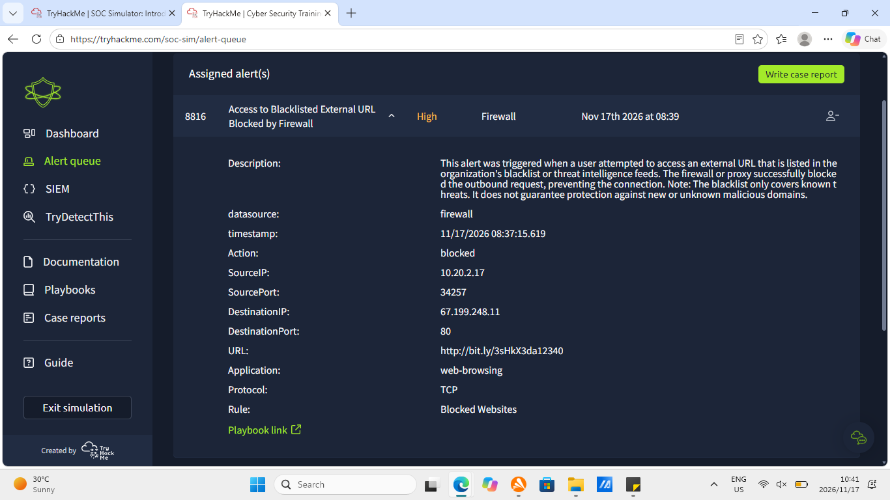
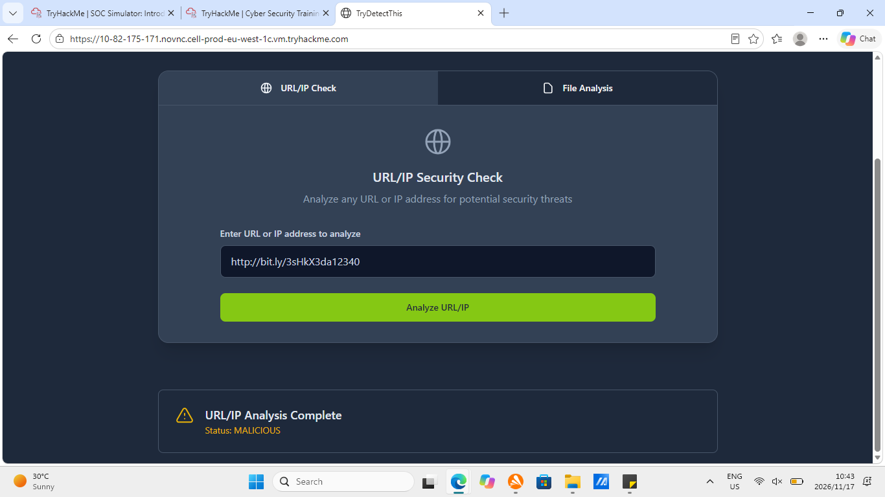
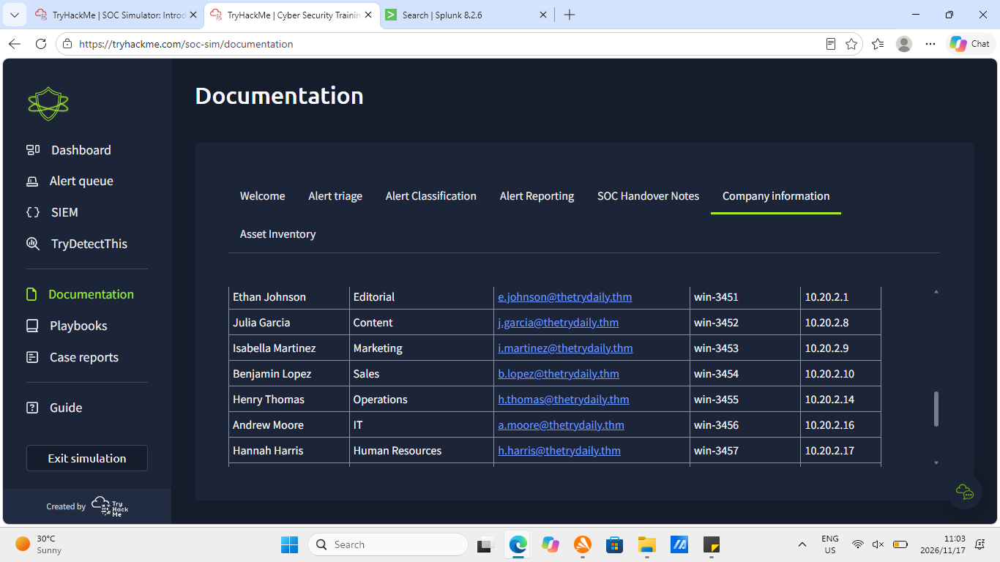

# Alert 8816: Access to Blacklisted External URL Blocked by Firewall

**Platform:** TryHackMe SOC Simulator (training environment, simulated data)
**Alert severity:** High
**Classification:** True positive
**Escalation required:** Yes
**Tools used:** Splunk, TryDetectThis, asset inventory (documentation)
**Related alert:** 8815 (the phishing email that delivered this URL)

## Alert details

The firewall blocked an outbound connection from 10.20.2.17 to hxxp://bit[.]ly/3sHkX3da12340 (destination IP 67[.]199[.]248[.]11, port 80) at 08:37:15, under the "Blocked Websites" rule.

## Investigation steps

### 1. Reputation checks (TryDetectThis)
Both the URL and the destination IP returned MALICIOUS.

### 2. Search for the link in Splunk (all time)
Two events were found: the blocked firewall connection at 08:37:15, and an inbound email at 08:36:01 from urgents@amazon[.]biz to h.harris@thetrydaily[.]thm that contains the link.

### 3. Search for the destination IP in Splunk (all time)
One event was found: the same blocked connection at 08:37:15.

### 4. Asset inventory
Used to match the source IP 10.20.2.17 to Hannah Harris (Human Resources, win-3457).

### 5. Related evidence from alert 8815
The same email and host were investigated in alert 8815, which includes:
- An all-time search of the sender, which returned one email to one recipient: [sender search](../alert-8815/screenshots/A8815-SplunkSearch4.png)
- An all-time search of host 10.20.2.17, which returned two events: [host search part 1](../alert-8815/screenshots/A8815-SplunkSearch3a.png) and [part 2](../alert-8815/screenshots/A8815-SplunkSearch3b.png)

## Case report

**Time of activity:**
On 11/17/2026 at 08:36:01, a phishing email from urgents@amazon[.]biz containing the link hxxp://bit[.]ly/3sHkX3da12340 was delivered to h.harris@thetrydaily[.]thm. At 08:37:15, approximately one minute later, the firewall blocked a connection attempt from 10.20.2.17 (h.harris's workstation) to that link (destination IP 67[.]199[.]248[.]11, port 80), which triggered this alert.

**List of Affected Entities:**
- User: h.harris@thetrydaily[.]thm (Hannah Harris, Human Resources), recipient
- Host: win-3457 (10.20.2.17), recipient workstation
- Sender: urgents@amazon[.]biz
- URL: hxxp://bit[.]ly/3sHkX3da12340
- Destination IP: 67[.]199[.]248[.]11

**Reason for Classifying as True Positive:**
1. The email impersonates Amazon using the look-alike domain amazon[.]biz. Amazon's legitimate domain is amazon.com.
2. The email uses a generic greeting ("Dear Customer"), creates urgency ("Action Required", "within 48 hours"), and asks the recipient to click a link to confirm shipping information.
3. The link uses the bit[.]ly URL shortener, which hides the real destination.
4. The URL and the destination IP (67[.]199[.]248[.]11) were both analyzed in TryDetectThis and returned a status of MALICIOUS.
5. Firewall logs show that 10.20.2.17 attempted to connect to the URL at 08:37:15, about one minute after the email was delivered to the user of that workstation. The connection was blocked by the "Blocked Websites" rule, which indicates the recipient's host attempted to open the link.
6. All-time Splunk searches for the URL and the destination IP matched only this email and this blocked connection.
7. An all-time search of the sender (see alert 8815) returned a single email sent to a single recipient, so no other employees received email from this sender.

**Reason for Escalating the Alert:**
The firewall blocked the connection, but the recipient's host attempted to open the link, so it should be checked to confirm that nothing else was downloaded or executed. Blocking the sender domain at the email gateway and removing the email from the mailbox also require permissions beyond L1.

**Recommended Remediation Actions:**
1. Block the sender domain amazon[.]biz at the email gateway.
2. Block the URL hxxp://bit[.]ly/3sHkX3da12340 at the firewall or proxy. The destination IP 67[.]199[.]248[.]11 can also be blocked, but it may be shared infrastructure, so blocking the URL is the priority.
3. Delete the phishing email from h.harris's mailbox.
4. Check host 10.20.2.17 (win-3457) for signs of compromise.
5. Notify h.harris that the email was phishing and provide phishing awareness guidance.

**List of Attack Indicators:**
- Sender: urgents@amazon[.]biz
- Subject: "Your Amazon Package Couldn't Be Delivered – Action Required"
- URL: hxxp://bit[.]ly/3sHkX3da12340
- Destination IP: 67[.]199[.]248[.]11
- All-time Splunk search of the sender (alert 8815): one email, one recipient
