# Alert 8817: Inbound Email Containing Suspicious External Link

**Platform:** TryHackMe SOC Simulator (training environment, simulated data)
**Alert severity:** Medium
**Classification:** True positive
**Escalation required:** Yes
**Tools used:** Splunk, TryDetectThis, company information (documentation)

## Alert details

An inbound email from no-reply@m1crosoftsupport[.]co to c.allen@thetrydaily[.]thm triggered a suspicious external link alert. The email claims there was an unusual sign-in attempt on the recipient's Microsoft account and asks the recipient to click a link to review the activity.

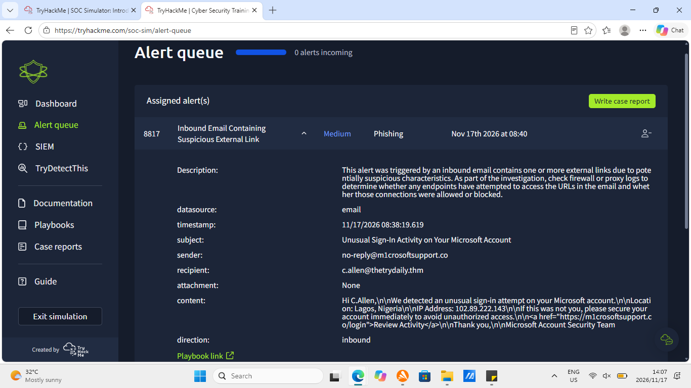

## Investigation steps

### 1. Reputation checks (TryDetectThis)
- Sender address: CLEAN
- IP address quoted in the email body (102[.]89[.]222[.]143): CLEAN
- URL (hxxps://m1crosoftsupport[.]co/login): MALICIOUS
- Destination IP of the URL (45[.]148[.]10[.]131): MALICIOUS

A clean result only means an address is not on a known-bad list. It does not make the sender legitimate.

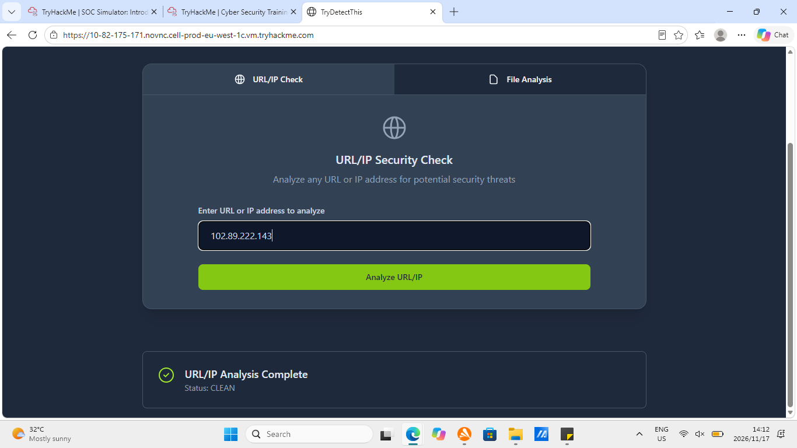
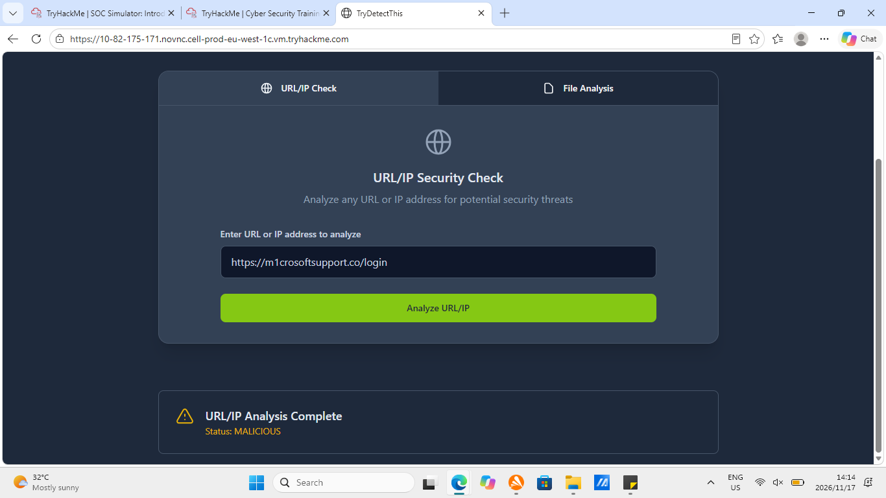
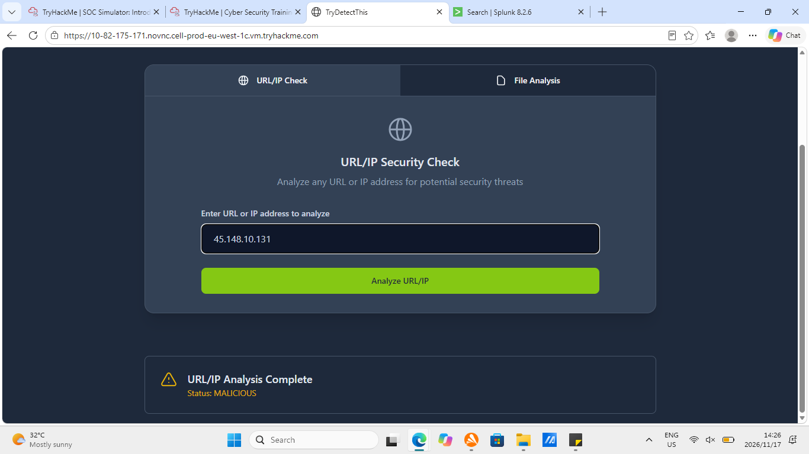

### 2. Search for the quoted IP in Splunk (all time)
One event was found: the email under investigation.

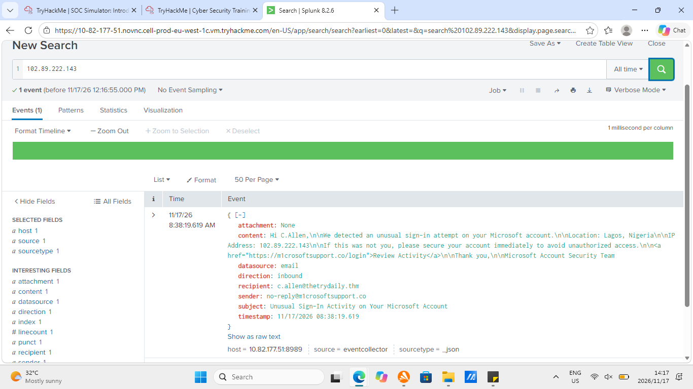

### 3. Search for the sender in Splunk (all time)
One event was found: the email under investigation. No other employees received email from this sender.

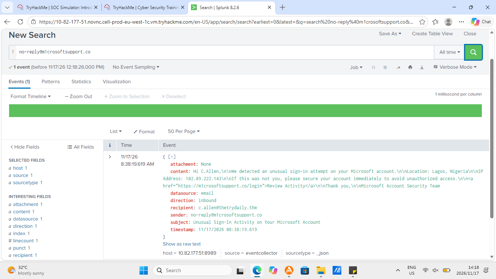

### 4. Search for the URL in Splunk (all time)
Two events were found: the email at 08:38:19, and a firewall event at 08:39:28 showing that a connection from 10.20.2.25 to the URL was **allowed** by the Allow-Internet rule.

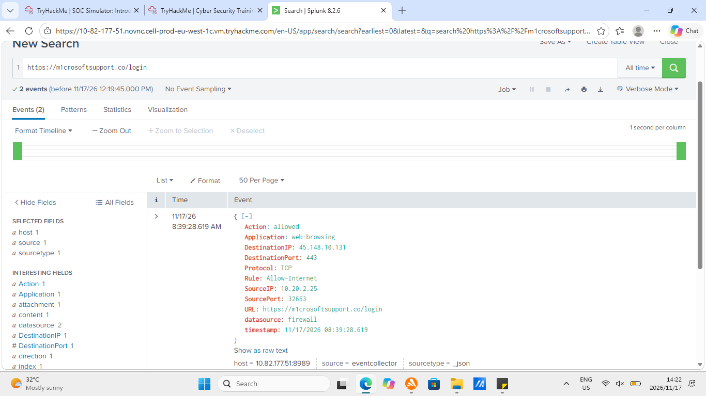
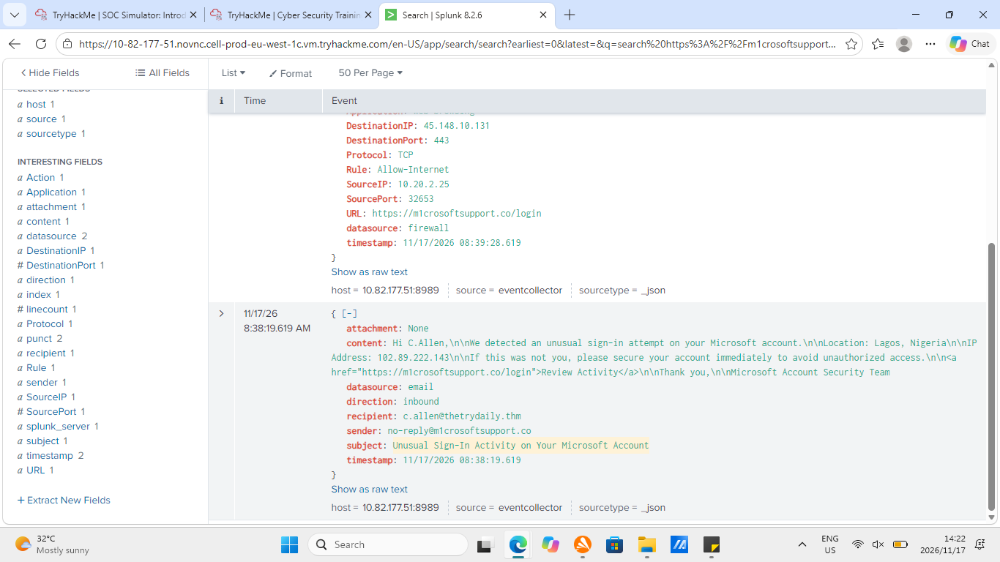

### 5. Search for the destination IP in Splunk (all time)
One event was found: the same allowed connection at 08:39:28.

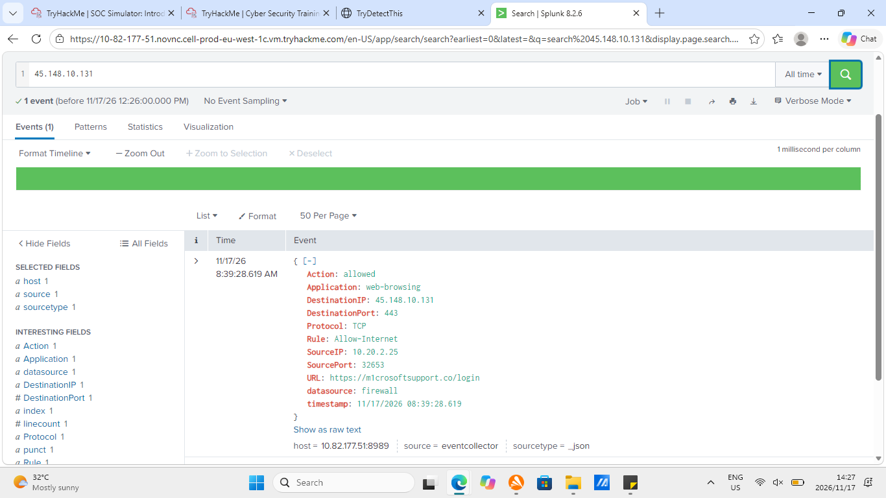

### 6. Firewall activity for the recipient's host (10.20.2.25)
The search returned 7 events. The screenshots show three of them: an allowed connection to an internal page (admin.thetrydaily[.]thm) at 08:39:02, the allowed connection to the malicious URL at 08:39:28, and an allowed Google search at 08:40:29.

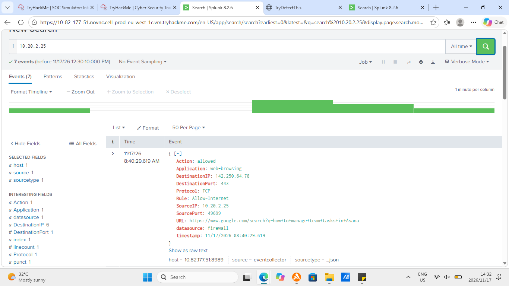
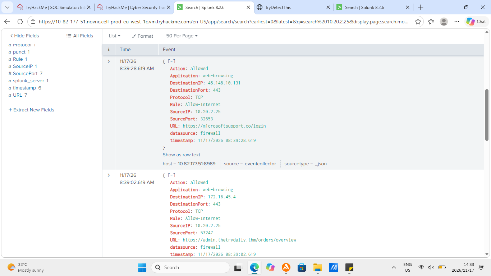

### 7. Documentation
Used to match the host 10.20.2.25 to the recipient, Charlotte Allen (Web Development, win-3463).

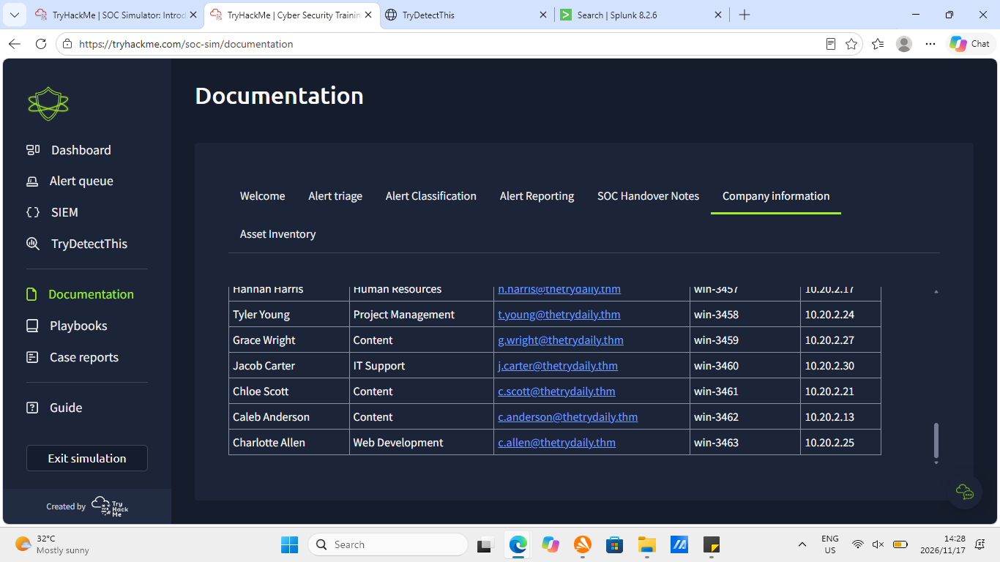

## Case report

**Time of activity:**
On 11/17/2026 at 08:38:19, a phishing email from no-reply@m1crosoftsupport[.]co was delivered to c.allen@thetrydaily[.]thm, which triggered the alert. At 08:39:28, approximately one minute after delivery, the firewall allowed a connection from 10.20.2.25 (c.allen's workstation) to hxxps://m1crosoftsupport[.]co/login (destination IP 45[.]148[.]10[.]131, port 443).

**List of Affected Entities:**
- User: c.allen@thetrydaily[.]thm (Charlotte Allen, Web Development), recipient
- Host: win-3463 (10.20.2.25), recipient workstation
- Sender: no-reply@m1crosoftsupport[.]co
- URL: hxxps://m1crosoftsupport[.]co/login
- Destination IP: 45[.]148[.]10[.]131

**Reason for Classifying as True Positive:**
1. The email impersonates Microsoft using the look-alike domain m1crosoftsupport[.]co, which replaces the letter "i" with the number "1."
2. The email uses urgency and fear ("unusual sign-in attempt," "secure your account immediately") and directs the recipient to a login page, which is consistent with credential phishing.
3. The URL and its destination IP (45[.]148[.]10[.]131) were analyzed in TryDetectThis and both returned MALICIOUS. The sender address and the IP quoted in the email body (102[.]89[.]222[.]143) returned CLEAN, which only means they are not on a known-bad list and does not make the email legitimate.
4. All-time Splunk searches for the sender and the quoted IP each returned a single event, matching only this email. No other employees received email from this sender.
5. An all-time Splunk search for the URL returned two events: the email at 08:38:19 and a firewall event at 08:39:28 showing the connection from 10.20.2.25 to the URL was allowed by the Allow-Internet rule. The destination IP search returned the same single allowed connection. This means the recipient's host reached the malicious site.
6. The source IP 10.20.2.25 was matched to c.allen using the asset inventory.

**Reason for Escalating the Alert:**
The firewall allowed the connection, so the recipient's host reached a malicious login page and credentials may have been submitted. The account and workstation need to be checked for compromise, the password needs to be reset, and the sender domain and destination need to be blocked. These actions require permissions beyond L1.

**Recommended Remediation Actions:**
1. Reset c.allen's password, revoke active sessions and review the account for suspicious sign-ins.
2. Check host 10.20.2.25 (win-3463) for signs of compromise.
3. Block m1crosoftsupport[.]co and the destination IP 45[.]148[.]10[.]131 at the firewall or proxy.
4. Block the sender domain m1crosoftsupport[.]co at the email gateway.
5. Delete the phishing email from c.allen's mailbox.
6. Notify Charlotte Allen that the email was phishing, ask whether she entered any credentials, and provide phishing awareness guidance.

**List of Attack Indicators:**
- Sender: no-reply@m1crosoftsupport[.]co
- Subject: "Unusual Sign-In Activity on Your Microsoft Account"
- URL: hxxps://m1crosoftsupport[.]co/login
- Domain: m1crosoftsupport[.]co
- Destination IP: 45[.]148[.]10[.]131
- All-time Splunk search of the sender: one email, one recipient
